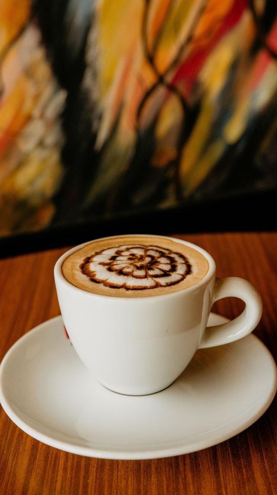

# Coffee Junkie

A beginner-friendly website project created as part of an **HTML and CSS
lesson**. The project demonstrates how to structure web pages with HTML,
apply shared styling with an external CSS file, display images, create
navigation links, and organize reusable page sections.

## Project overview

The website is for a fictional coffee shop called **Coffee Junkie**. It
is made from several HTML pages and a shared stylesheet.

### What I built

-   A main page that loads the navigation menu and footer.
-   A separate menu page containing the website title, a welcome
    message, a coffee image, and navigation links.
-   A separate footer page containing general and contact information.
-   Navigation links to the Home, About Us, Contact, and Products pages.
-   Email links using both `mailto:` and a Gmail compose URL.
-   An external CSS file for styling the pages.

## Project structure

The project is organized approximately like this:

``` text
Coffee-Junkie/
│
├── index.html
├── menu.html
├── footer.html
├── about_us.html
├── contact.html
├── products.html
│
├── css_files/
│   └── style.css
│
└── assets/
    └── coffee1.jpg
```

The names and folders should match the actual files in the project. Add
or remove entries above if your final folder structure is different.

## HTML concepts used

### 1. Basic HTML document structure

Each page starts with the HTML5 doctype and includes the main document
elements:

-   `<!doctype html>` tells the browser to use HTML5.
-   `<html lang="en">` identifies the page language as English.
-   `<head>` contains page information and links to resources.
-   `<meta charset="UTF-8">` supports a wide range of characters.
-   The viewport meta tag helps the page display correctly on different
    screen sizes.
-   `<title>` sets the browser-tab title.
-   `<body>` contains the content displayed on the page.

### 2. Headings, paragraphs, and lists

The project uses headings such as `<h1>` and `<h2>`, paragraphs with
`<p>`, and an unordered list with `<ul>` and `<li>` to organize content.

### 3. Images

The menu page displays an image using the `` element:

``` html

```

-   `src` specifies the image file path.
-   `alt` provides alternative text if the image cannot be displayed and
    supports accessibility.
-   `height` and `width` set the image dimensions.
-   `class` allows CSS to target the image.

### 4. Links and navigation

The navigation menu uses anchor elements:

``` html
<ul>
  <li><a href="index.html" target="_top">Home</a></li>
  <li><a href="about_us.html" target="_top">About Us</a></li>
  <li><a href="contact.html" target="_top">Contact</a></li>
  <li><a href="products.html" target="_top">Products</a></li>
</ul>
```

The `href` attribute specifies the destination. The `target="_top"`
attribute is useful because the menu is displayed inside an iframe: it
makes the selected page open in the full browser window instead of
inside the iframe.

### 5. Reusing page sections with iframes

The main page loads the menu and footer from separate HTML files:

``` html
<iframe
  src="menu.html"
  width="100%"
  height="550"
  style="border: none"
></iframe>

<iframe
  src="footer.html"
  width="100%"
  height="250"
  style="border: none"
></iframe>
```

An `<iframe>` embeds another HTML page inside the current page. Keeping
the menu and footer in separate files means their content can be
maintained independently and reused on other pages.

The iframe heights are set manually. If the embedded content changes,
the height may need to be adjusted to avoid extra blank space or
scrollbars.

### 6. Email links

The footer demonstrates two ways to create an email link.

**Default email application:**

``` html
<a href="mailto:info@coffeejunkie.com">
  info@coffeejunkie.com
</a>
```

This asks the visitor's device to open its configured email application.

**Gmail compose page:**

``` html
<a
  href="https://mail.google.com/mail/?view=cm&fs=1&to=magkas9@gmail.com"
  target="_blank"
>
  Send an email with Gmail
</a>
```

This opens Gmail's compose page in a new tab. The visitor may need to
sign in to Gmail. The `to` parameter sets the recipient address.

## CSS concepts used

The HTML pages connect to an external stylesheet:

``` html
<link rel="stylesheet" href="./css_files/style.css" />
```

This keeps presentation rules separate from the page content. CSS
classes, such as `title`, `description`, `menu`, and `footer`, can be
used to style specific elements.

For example:

``` css
.title {
  text-align: center;
}

.description {
  font-size: 18px;
}

.footer {
  text-align: center;
}
```

A class selector starts with a dot (`.`) in CSS and matches HTML
elements that have the corresponding `class` attribute.

## What I learned

Through this project, I practised:

-   Creating HTML5 documents.
-   Using headings, paragraphs, lists, images, and links.
-   Connecting HTML pages to an external CSS stylesheet.
-   Using CSS classes to select and style elements.
-   Organizing a project into separate HTML, CSS, and image files.
-   Embedding reusable page sections with iframes.
-   Using `target="_top"` for links inside an iframe.
-   Creating email links with `mailto:` and a Gmail compose URL.
-   Using basic accessibility features such as image `alt` text.

## Possible improvements

The project can be developed further by:

-   Making the layout responsive for mobile devices.
-   Adding more coffee product images and descriptions.
-   Improving the navigation and footer design with CSS.
-   Using a shared layout approach that does not require iframes.
-   Checking that every navigation link points to an existing page.
-   Adding consistent spacing, colors, and typography.

## How to open the project

1.  Keep the HTML files, `css_files` folder, and `assets` folder in the
    same project directory structure.
2.  Check that the image path and stylesheet path match the actual file
    locations.
3.  Open `index.html` in a web browser.
4.  Use the navigation links to visit the other pages.

------------------------------------------------------------------------

*Created as a learning exercise for HTML and CSS. @Copyright 2026*
